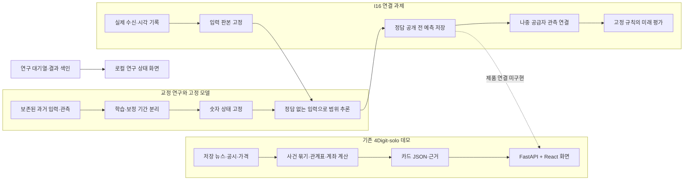

# 밤사이 브리핑: 현재 구현 구조와 통합할 자리

개발 구현용 기술 명세서: [`technical_spec.md`](technical_spec.md) · [공유본](https://claude.ai/artifact/Vv3mg9oe9btMbMMK6rUpX2)

기준일: 2026-11-06. **로컬 구현 현황·통합 제안이며 팀 승인된 제품 아키텍처가 아니다.** 이번 로컬 교정이 노션이나 외부 공유 문서까지 갱신됐다는 뜻은 아니다. 세부 모델 설명은 [모델·설계 설명서](overnight_model_design.md), 최신 실행 상태와 완료 기준은 [연구 대기열](../../research/overnight_backtest/workbench/research_queue.json)을 따른다.

**한 장 구조도(2026-11-02):** [4Digit 서비스 아키텍처](https://claude.ai/artifact/LpngQ4G3NiYsS64Wqacdpy), 원본 [architecture_overview.html](architecture_overview.html). 팀 승인 전 구조안이다. **모델 설계서 공유본:** [4Digit 모델 설계서](https://claude.ai/artifact/4FpcMwsa9hdfDspMV39eX6), 정본은 [overnight_model_design.md](overnight_model_design.md)이고 `docs/design/_build/build_model_design_page.py`로 만든다.

## 지금 만들어진 것

| 구성 | 실제 코드 | 현재 역할 | 아직 연결되지 않은 것 |
|---|---|---|---|
| 기존 단독 브리핑 데모 | `4Digit-solo/nightbrief/`, `server/`, `web/` | 과거 두 밤의 뉴스·공시·관계표·예시 계좌를 재생하고 카드·근거 화면 표시 | 새 범위 모델·I16의 실수신 기록 |
| 교정 연구·비교 모델 | `research/overnight_backtest/workbench/` | 과거 자료의 시각·대조군·평가 오류 교정과 후보 비교 | 독립된 미래 성과 근거 |
| 고정 범위 추론 | `workbench/frozen_range.py` | 과거 학습·보정으로 고정한 숫자 상태와 정답 없는 입력에서 범위 폭 산출 | 실제 수신에서 입력을 만드는 운영 경로 |
| 사전 기록 기반 I16 | `prospective_journal.py`, `capture_probe.py`, `provider_outcome.py`, `provider_evidence.py` | 수신·예측·관측의 순서와 판본을 보존하고 잘못된 연결 거부 | 실제 시장 수신부터 미래 관측까지의 종단 운영 |
| L1 단일 수신 실행기 | `workbench/l1_run.py`와11/2 비활성 실행 명세 | 준비·검토를 마쳤지만 11/2 창은 미실행으로 종료. 당시 명세와 실패 분모 보존 | 새 미래 슬롯의 구체 계약·실행자 일정 확인. 늦은 호출이나 날짜 교체로 대체하지 않음 |
| 아침 카드·실제 날짜 입력 어댑터 | `workbench/morning_card.py`, `live_panel.py`, `live_refresh.py` | H·S1 종목 범위·D08 등급·보유금액을 JSON으로 산출. 과거·실제 날짜 사후 입력 경로가 있음 | I16 수신·사전 봉인과 결속, 사용자 보유 입력 및 앱 표시. 로컬 날짜·해시만으로 사전 발행을 입증하지 않음 |
| 연구 상태 화면 | `workbench/render_status.py` → `status.html` | 정본 대기열·결과 색인의 읽기 전용 표시 | 실시간 시세·예측 실행 기능 |

현재 연구가 기존 앱에 이미 배포된 것처럼 설명하지 않는다. 화면·기록 장치가 존재하는 것과 미래 예측 성과가 입증된 것은 각각 다른 사실이다.

**10/30 사용자 우선순위 정정:** 기존 구현을 뒤집지 않는다. 최종 목표는 실사용 유용성이며 07:30·범위 수준·계좌 띠·모형 방식은 검증 결과에 따라 선택할 수단이다. 뉴스·사건과 가격 모델은 한 제품의 부품이다. 사건 설명 연결부터 재사용하되, 당시 이용 가능한 사건 특징의 예측 증분을 검증하여 수치모형까지 통합하는 경로도 유지한다. 현재 미구현/미검증 표시는 영구 제외 결정이 아니다. 11/2 L1의 미실행 명세·분모는 보존하며 새 실행일은 미지정이다. 계좌 연구를 L1의 선행 조건으로 만들지 않는다.

## 데이터가 지나가는 길

위 `future` 상자는 목표 경로다. 개별 오프라인 부품이 준비됐어도 화살표 전체의 실수신 실행이 완료됐다는 뜻은 아니다. 수신·예측·관측의 실제 건수는 [상태 화면](../../research/overnight_backtest/workbench/status.html)에 정본 대기열의 값으로 표시한다.

## 모델과 기록 장치의 책임

- **H**는 06시 시가 중심을 추정하는 기존 점예측 기준이다. 범위 추론과 동일한 모델이 아니다.
- **고정 범위 모델**은 `ewma`, `rng`, `rng_dis`를 함께 보존한다. NXT 가격을 중심으로 변동성, 첫 10분 분봉 종가의 범위, 06시 F2 추정과의 차이를 이용한다. 계산의 재현과 모델 성과 판정은 분리한다.
- **아침 카드의 S1 범위·D08 등급**은 이후 연구(E62–E64)의 별도 모형이다. S1은 H 중심에 H 과거 오차 규모·야간 수익률 절댓값·경험적 보정을 적용한다. D08은 NXT 방향과 시가 방향의 일치 가능성이다. 기존 `frozen_range`의 NXT 중심 모델과 같은 판본으로 취급하지 않으며, L2가 사용할 모델·상태·입력 연결은 계약에서 명시한다.
- **I16 기록 장치**는 입력·모델·예측·나중 관측의 관계를 증명하는 기반이다. 사후 백필을 사전 예측으로 바꾸지 않고, 정정된 관측이 최초 기록을 덮어쓰지 못하게 한다.
- **공급자 관측 벤치마크**는 `KIS-J-raw-opening-observation-v1`처럼 이름을 구분한다. 공급자의 반환값을 KRX 공식 정규장 시가와 같다고 단정하지 않는다.
- **제품 화면**은 검증된 산출물만 읽도록 통합해야 한다. 실제 도착 지연·결측·예측 불가 상태도 함께 보여 줘야 한다.

자세한 수식·후보 선택 이유·과거 결과의 해석은 [모델·설계 설명서](overnight_model_design.md)에 한 번만 관리한다.

## I16 첫 종단 연결까지의 유한한 순서

정확한 완료 기준과 현재 담당은 대기열의 `delivery_roadmap`이 우선한다. 아래는 구조를 설명하는 단계 지도다.

이 단계의 종료는 실제 수신·사전 예측·관측·화면이 처음 이어졌다는 뜻이다. 통합 서비스 전체나 사용자 효용·성능 채택 검증의 종료선은 아니다.

1. **C2-1 저장 증거 연결(오프라인 완료):** 등록 앵커, 로컬 보관 완료 근거, 전일 종가 판본을 기존 관측 검증기에 연결한다. 성공뿐 아니라 저장 실패·불명 상태도 보존한다.
2. **L1 실제 수신 한 번:** 별도 운영 계약에서 날짜·종목·창·출처·인증 접근·실패 처리를 고정하고, 정해진 창 안에서 실제 수신 및 저장을 확인한다. 창을 놓쳤으면 뒤늦게 성공으로 대체하지 않는다.
3. **L2 첫 사전 예측과 관측 연결:** 출처가 정해진 입력과 고정 모델 상태로 정답 공개 전에 예측을 저장하고, 나중 관측과 연결한다. 여기까지가 첫 종단 실행의 완료다.
4. **독립 미래 연구:** 고정된 비교·표본·평가 계획으로 미래 기록을 모은다. 첫 실행의 성공만으로 모델 채택·실서비스 운영·미래 성과 우위를 선언하지 않는다.

여러 합성 검사의 통과 횟수를 미래 성과의 근거로 더하지 않는다. 완료된 단계는 새 오류나 요구 변경이 있을 때만 다시 연다. 새 과거 탐색이나 검증 목표의 무한 추가를 이 경로의 선행 조건으로 만들지 않는다.

## 화면과 실행 경계

현재 볼 수 있는 것은 [연구 상태 화면](../../research/overnight_backtest/workbench/status.html)과 [실험 장부](../../research/overnight_backtest/docs/experiments.html)다. 상태 화면은 외부 통신·자바스크립트·API 호출 없이 생성되는 정적 HTML이며, 생성 시각 이후 자동 갱신되지 않는다.

기존 `4Digit-solo` 데모는 별도 React/FastAPI 앱이다. `server/app.py`의 브리핑 조회는 저장 결과가 없거나 엔진이 바뀌었으면 재생기를 호출하므로 읽기 전용 파일 뷰어로 간주하지 않는다. 새 I16 값을 제품에 표시하려면 결과 조회 계약을 연결하고, 과거 데모·현재 관측·모델 추정을 구분하는 화면 표기가 필요하다.

기존 데모의07:59 입력 시각 제한도 유지한다.08시 관측을 그 제한 안으로 위장하거나 제한을 풀어 섞지 않는다. L2는 이미 봉인된 예측 ID를 읽는 별도 조회 경로와 표시를 설계한다. 현재 이 경로는 미구현이다.

## 노란띠·개인화의 제품 계약

6월 25일 사건 연결 화면(C)을 읽는 과제에는 시각별 정지 이미지 두 장을 쓴다. 두 장 모두 같은 가정 계좌표·출처 설명을 사용한다. 진행자는 다섯 문항에서 장면에 근거가 있는 답과 ‘알 수 없음’이 맞는 답을 구분한다. 참여자 모집 전이며 계좌 예측구간의 성능은 별도 평가 대상이다. [07:30 C](../../research/overnight_backtest/workbench/presentation/c_reading/0730.png) · [08:11 C](../../research/overnight_backtest/workbench/presentation/c_reading/0811.png) · [채점 근거, 설계서 §11.6](overnight_model_design.md)

정확한 수식·예시·용어는 [설계서 v2 §4·§5·§7.3·§11](overnight_model_design.md)에 둔다. 여기서는 모듈 경계를 고정한다.

- **관측·추정 구분:** 06시 H는 시가 중심 추정, 08시 NXT는 관측값이고, 노란띠는 공급자 일봉 시가 한 값의 참고 범위다. 장중 경로·손실한도·계좌 전체의 80% 보장으로 표시하지 않는다. [E51 결과](../../research/overnight_backtest/workbench/runs/codex_e51_r1/summary.json)는 단순 과거오차 분위 대비 EWMA 표준화의 추가 우위를 확인하지 못했고 실제 Claude 답10에서 해석·종료를 수용했다. 단순 방식(raw)이 더 낫다고 입증한 것도 아니다. 이후 E60·E62의 별도 후보 S1이 개정된 과거 평가 기준을 통과해 아침 카드에 들어갔으며, 자료 재사용·기준 개정 한계는 설계서 §7.5–7.6에 둔다. 계좌 AS1은 해당 기준 미달로 숫자를 제공하지 않는다. 이 연구 결과가 I16 실수신·미래 성능이나 팀 채택을 뜻하지 않는다.
- **계좌 예측구간과 금액의 표시 범위.** 지원 종목의 수량을 반영한 06시 참고 변화액과 사용자 가정 합계를 제공하는 방향이다. 여러 종목의 계좌 범위는 E63·E87·E92에 이어 07:30 공통 오차 분리(E96)와 저녁 가격 반영(E97)도 과거 기준에 미달해 값을 비운다. 종목 하나와 원화 현금만 있는 계좌의 환산 예시, 기존 후보와 수치 비교, 다시 판단할 조건은 [모델 설계서 §5.6](overnight_model_design.md)에 있다.
- **E87(11/5):** AS1의 밤 크기 조절은 그대로 두고 폭을 정하는 방법만 바꾼 세 후보를 검증 표본 54일·31,290계좌·일에서 비교했다. 조용한 밤 포함률은 기준 AS1-M 72.09%, 위·아래 폭을 따로 정한 A 73.23%, 종목별 재축척 공동 척도 B 71.65%, 둘을 합친 C 73.60%로 모두 75%에 못 미쳤다. A의 구간점수 2.07% 개선은 신뢰구간이 0을 포함했고 개발 표본에서는 1.46% 나빴다. B·C는 구간점수가 각각 6.30%·3.83% 나빠졌다. 평가 구간이 미달 원인을 진단한 같은 날들이어서 A·C의 개선은 채택 근거가 아니다. [결과 요약](../../research/overnight_backtest/workbench/runs/codex_e87_r1/summary.json)
- **E92(11/6):** 보유 종목의 08:10 NXT 갭을 비중대로 평균한 값 G를 중심으로 둔 조건부 폭 GC를, 중심만 G로 바꾼 G0, G 중심의 단순 순위 폭 GR0와 비교했다. 개발 표본 86일에서 GC는 G0보다 구간점수가 23.77% 좋았지만 GR0보다 낫다는 것은 확인되지 않았다(1.62%, 신뢰구간이 0을 포함). G0 대비 개선에는 G0의 폭이 G 중심에 비해 너무 넓은 탓이 섞였을 수 있지만, 그 몫을 따로 나눠 재지는 않았다. 조용한 밤이 14일뿐이어서 전체 판정은 '판정 불가'다. 검증 표본의 조용한 밤에서는 중심만 옮긴 G0가 아래로 벗어난 비율을 22.80%에서 11.41%로 줄였지만, 포함률이 87.40%로 너무 넓고 같은 날들에서 신호를 처음 봤기 때문에 단서까지만이다. GC는 아래로 벗어난 비율이 22.83%로 그대로였다. 보유 종목 모두의 NXT 관측이 있어야 계산되므로, 결과는 그런 계좌·일에만 해당한다(10종목 계좌는 비교 가능한 행이 10.55%). [결과 요약](../../research/overnight_backtest/workbench/runs/codex_e92_r1/summary.json)
- **실행 전 입력 점검(11/5):** 08:11 계좌 비교를 하기 전에, 보유 종목 모두의 NXT 관측이 있는 계좌·일이 얼마나 되는지만 먼저 셌다. 검증 표본의 10종목 계좌는 150개 중 21개만 한 번이라도 입력이 갖춰졌다(8,400계좌·일 중 1,021, 12.15%). 저장 자료의 입력 범위일 뿐, 그 계좌들이 앞으로도 지원되지 않는다는 뜻은 아니다. 이 점검을 근거로 '필수 집단의 채점 날짜가 20일 미만이면 판정 불가'라는 규칙을 E92에 넣었다. 기존 코드는 공통 채점일이 20일에 미달하면 날짜 신뢰구간을 보고하지 않는다. 이 보고 하한과 별도로 판단에 필요한 정밀도와 검정력을 검토한다. [입력 점검](../../research/overnight_backtest/workbench/exchange/31_0811_input_feasibility.json)
- **장중 지속과 장 초반 흔들림(E90·E91, 11/5, 실제 Claude):** 크레온 1분봉으로 과거 실험을 넓혀 보니, '시가 뒤 갭 방향으로 더 간다고 볼 근거가 없다'는 결론(E23)이 2년치에서도 유지됐다. E23이 보지 않은 해에는 갭 방향으로 이어진 비율이 43.2%였다. 장 초반(09:00~09:30) 흔들림 크기 예보는 199종목과 예시 계좌 4개에서 '직전 60일 중앙값'보다 나았다. 두 결과 모두 계좌 시가 예측구간과는 다른 목표라 계좌 숫자 보류를 바꾸지 않는다. 자세한 내용은 설계서 §8.6과 [README](../../research/overnight_backtest/workbench/runs/claude_creon_usb_r1/README.md)에 있다.
- **입력·코드 교차 검증(E81·E88·E89, 11/5, 실제 Claude):** 팀 저장소의 KRX 백테스트(반도체 15종목)를 독립 구현으로 두고 우리 입력과 코드를 맞춰 봤다(E81). 14종목·2025-06-11~2026-10-26에서 시가·전일 종가·시가갭 3,864행, 야간 수익률 327/333일, 06시 점예측 함수(최대 차이 2e-15)가 모두 일치했다. 빠진 6일은 선물 만기 다음 날로, 수집기가 만기일 밤의 다음 계약을 받지 않는 문제(E82와 같음)였다. 크레온 1분봉 대조(E88)에서는 한국투자증권 과거 NXT 분봉이 시작 시각 표기이고 받은 날 기준 수정주가라는 점을 사후에 확인했고, 저장 자료의 기업 행사일 가짜 갭은 없었다. 크레온으로 2025-07~10의 NXT 값을 채워 보니 08:11 등급(D08)과 '시장 몫 + 그 밖' 분해가 처음 보는 74일에서도 기준을 통과했다(E89). 모두 저장 자료의 과거 검증이며 실시간 수신·미래 성능의 증거가 아니다. [E81 README](../../research/overnight_backtest/workbench/runs/claude_krx_crosscheck_r1/README.md) · [E88~E91 README](../../research/overnight_backtest/workbench/runs/claude_creon_usb_r1/README.md)
- **개인화 계산:** 수량·전일 기준가격·현금·입력 기준시각을 받아 종목 변화의 원 금액과 계좌 중심 합계를 계산한다. 미지원 종목은 0으로 바꾸거나 조용히 제외해 재가중하지 않는다. 종목 구간의 끝점을 합산해 계좌 80% 띠라고 부르지 않는다. 이 제품 연결은 설계 단계다.
- **노란띠(만약에):** 노란띠와 만약에는 한 기능이다. 띠가 만약에의 기본 범위이고, 사용자가 띠 위 표식을 움직이면 가정 금액을 계산한다. 사용자의 가정이 띠 자체나 믿을 정도 표시를 바꾸는 것처럼 보이지 않게 한다.
- **뉴스 연결:** 현재 재사용할 수 있는 것은 사건과 종목의 관련 근거·시각을 붙이는 설명 계층이다. 향후 사건 특징→시장 기준 대비 증분 검증→승인된 모델 판본→예측 ID의 경로를 연결한다. 관련성만으로 띠를 이동하거나 인과·예상 손익을 만들어내지 않는다. 뉴스 카드의 색과 구간의 색 의미를 분리한다.
- **두 사용자군:** 사용자가 선택한 기존 보유자와 당일 매매자의 기능·검증을 분리한다. 시가 계좌 평가변화의 정확도가 시가 이후 매매 가치의 증거가 되지 않는다. 시간 절약·이해·확인 순서는 사용자 연구, 통계 예측력은 고정 대조 실험으로 판단한다.
- **화면 후보 시안(2026-10-30, 실제 Claude):** [아침 화면 후보](https://claude.ai/artifact/HEKRHPS5LtWvgys7b7mKTz). 2026-06-25 아침 하나를 결과를 보고 골라, 가정 계좌(6종목 + 현금, 주수 명시) 위에 저장된 06시 H·NXT 08:10·80% 범위·실제 시가를 얹었다. 잔고형·시간축·소식 중심 세 안과 07:30 → 08:11 → 09:00 전환, 종목별 만약에가 들어 있다. 디자인 탐색용이라 계좌 확률띠는 내지 않는다. 연결 표시는 추정·확인 필요, 소식은 과거 재생이다. 제품 채택이나 검증 결과가 아니다.
- **11/5 아침 카드 교정(Codex):** 아침 카드 코드에서 다음을 고쳤다. 07:30 카드가 같은 날 08:10 NXT 정보를 쓰지 않게 막았고, NXT 갭이 0이거나 비정상인 종목에는 등급을 내지 않는다. 비어 있는 등급 재료를 과거 중앙값으로 채운 경우와 카드를 목표 시각보다 늦게 만든 경우를 카드에 표시한다. 계좌 금액은 반올림 전 값으로 계산·합산한 뒤 표시만 반올림하고, 지원 종목만 합한 값과 계좌 전체 값을 구분한다. 가격을 모르는 제외 종목이 있으면 계좌 전체 값은 비운다. 실제 날짜 카드는 자료를 받은 시각을 먼저 확인해, 야간 자료는 그 밤이 끝난 다음 날 06:05 이후, NXT 등급 자료는 그날 08:11 이후에 받은 것만 쓴다. 이 확인을 통과했다고 실제 수신이나 장 전 봉인이 증명되는 것은 아니다. 관련 시험 45개가 통과했다. 지난 날짜를 다시 만들 때의 수집 생략 표시, 08:10 봉 완성 지연, 휴장일 사유 문구는 운영 단계에서 다시 본다. 필드 정의는 [기술 명세서](technical_spec.md) 1.4판에 있다.
- **아침 계산기·입력 연결(실제 Claude 구현, 11/5 현재):** `research/overnight_backtest/workbench/morning_card.py`가 과거 평가로 선택한 종목 S1 띠·08시 D08 등급·실적 공시와 월요일 주의 문구를 [설계서 §12.3](overnight_model_design.md)의 JSON으로 낸다. 계좌 띠는 값 없이 '후보'로 둔다. 실제 날짜는 `live_refresh.py`(연구 data/를 복사한 뒤 KIS·FDR·DART로 뒤 날짜를 이어 붙임)와 `live_panel.py`(i24_panel과 같은 함수, 입력 해시 기록)로 만든 패널을 넣는다. 같은 자료의 패널 값 동등성 검사가 있으며, 11/4 실제 날짜 입력 실행은 개장 뒤였다. 이 경로의 일반 API 자료 수신과 I16 계약 창 안의 수신 증거는 구분한다. 실제 개장 전 실행·외부 앵커 봉인은 아직이고 L1·L2 계약은 바꾸지 않았다. 11/5 인계 검토는 문서·구현 경계의 정적 검토이며 후속 E62–E86 전체의 독립 재검증이 아니다. 화면 모습은 [아침 카드 목업](https://claude.ai/artifact/4iUdJBghgbsrMjtEPnc3Jc)(E74 재생 숫자, 가정 계좌)에 있다. 표시 계약은 08:11에 07:30 띠를 유지하고 NXT 방향 일치 등급을 더하는 것이며, NXT 중심 08시 범위로 바꿀지는 팀 결정이다.
- **P1 연결 계약·로컬 수정 완료:** 필드와 완료선은 [설계서 v1 보관본 §11.9](archive/overnight_model_design_v1_20261103.md)에 한 번만 둔다. [현재 로컬 시안](../../research/overnight_backtest/workbench/presentation/morning_replay/index.html)은 실제 Claude가 표시를 수정하고 Codex가 원표·출처·변경 소스를 확인했다([31번](../../research/overnight_backtest/workbench/exchange/31_yellow_band_design_review.md)). 원본·출처는 같은 폴더 manifest에 보존한다. 위 외부 게시본은 이전 판본이며 자동 수정하지 않았다. 이 한정 시안 작업은 종료했지만 I16 실제 수신·사전 예측0건, 사용자 효용 미평가, DAST 미실행은 그대로다. 현재 인증 접근 확인과 이전 진단의 정정은 [설계서 v1 보관본 §11.9](archive/overnight_model_design_v1_20261103.md)에 두며, 당시 manifest는 수정하지 않는다.
- **자료 범위:** 넓은 지표 연구는 yfinance 시장가격·금리 중심이다. ECOS·발표 서프라이즈·엔트로피는 사용한 것으로 표시하지 않는다. 미래 추가 연구도 L1 실수신의 선행 조건으로 만들지 않는다.

## 공동 작업과 문서 갱신

- **Codex:** 작업대 README, 단일 연구 대기열, 결과 색인과 연결 상태 관리.
- **실제 Claude Code:** 같은 `exchange` 파일에 계약·코드·결과 반론을 남기고 맡은 실험 장부를 갱신. 모델끼리의 동의를 추가 통계적 증거로 세지 않는다.
- **이 문서:** 모듈 책임과 실제 연결이 바뀔 때 갱신. 실험별 수치·검토 전문은 복제하지 않는다.
- **팀 승인·노션 동기화:** 별도 사실로 확인해야 한다. 로컬 문서가 갱신됐다는 이유로 완료했다고 표시하지 않는다.

최근 실제 교환은 [I16 출처·저장 연결 검토](../../research/overnight_backtest/workbench/exchange/29_i16_source_contract_review.md), 과거 실험 종료 검토는 [E49 교환](../../research/overnight_backtest/workbench/exchange/30_claude_e49_plan_request.md)에 남긴다.

사용자의 최근 제품·방법론 요구와 반론은 [31번 노란띠·가치 검토](../../research/overnight_backtest/workbench/exchange/31_yellow_band_design_review.md)에 이어 쓴다. 현재 문서의 변경은 단일 대기열·결과 색인·README에 연결하고 상태 화면을 다시 생성한다. 과거 실험 결과·동결 계약은 소급 수정하지 않는다. 코드의 최종 통계·엔지니어링 판단과 제품 채택은 인간 검토 사항으로 남긴다.
